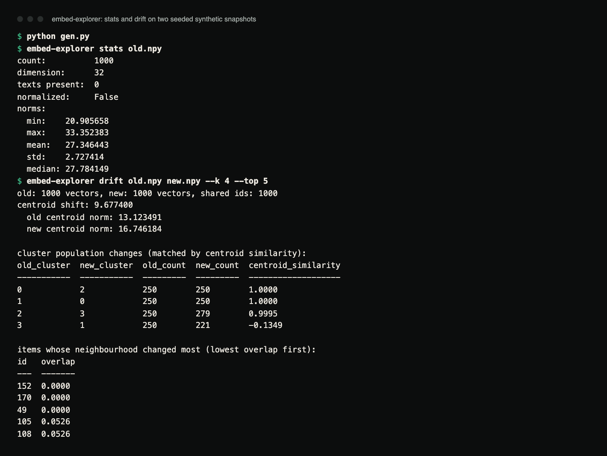
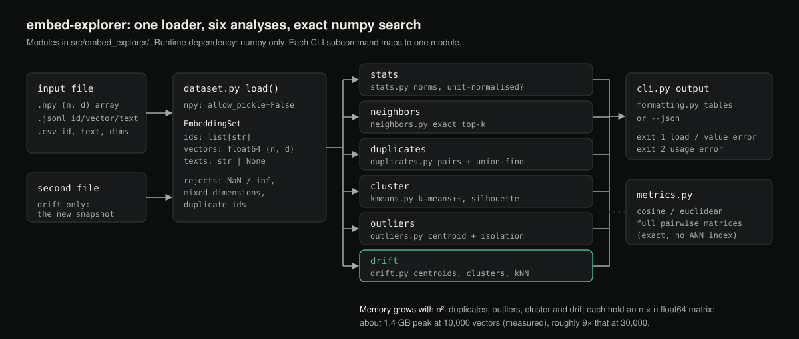

# embed-explorer

Explore an embedding space from the terminal: nearest neighbours, near-duplicates,
clusters, outliers, and drift between two snapshots, without opening a notebook.

[](https://github.com/hellpuffyt/embed-explorer/actions/workflows/ci.yml)
[](LICENSE)

**Status:** version 0.1.0, beta. Python 3.10 or newer, NumPy is the only
runtime dependency. CI runs the tests on Linux, macOS and Windows with Python
3.10 to 3.13. Not published to PyPI; install from source.

## What it does

`embed-explorer` is a command-line tool and a small Python library for
inspecting a set of embedding vectors. Point it at a `.npy`, JSONL or CSV file
of vectors (with optional ids and source text) and it tells you:

- what's near what (nearest neighbours, exact search),
- what's redundant (near-duplicate pairs and groups),
- how the space is organised (k-means clustering with a silhouette score),
- what doesn't fit anywhere (outliers), and
- what changed between two snapshots (centroid shift, cluster population
  changes, and which items' neighbourhoods moved the most).

## Demo

Two seeded synthetic snapshots: four Gaussian blobs, then the same points with
noise added and blob 0 moved onto blob 1, as a bad re-embedding might do.

```python
# gen.py
import numpy as np
rng = np.random.default_rng(0)
centers = rng.normal(size=(4, 32)) * 5
old = np.vstack([c + rng.normal(size=(250, 32)) for c in centers])
new = old + rng.normal(scale=0.3, size=old.shape)
new[:250] += centers[1] - centers[0]  # cluster 0 re-embedded onto cluster 1
np.save("old.npy", old)
np.save("new.npy", new)
```



*Terminal capture of `python gen.py`, `embed-explorer stats old.npy` and the
drift run below (real output, rendered from the saved transcript).*

```
$ embed-explorer drift old.npy new.npy --k 4 --top 5
old: 1000 vectors, new: 1000 vectors, shared ids: 1000
centroid shift: 9.677400
  old centroid norm: 13.123491
  new centroid norm: 16.746184

cluster population changes (matched by centroid similarity):
old_cluster  new_cluster  old_count  new_count  centroid_similarity
-----------  -----------  ---------  ---------  -------------------
0            2            250        250        1.0000
1            0            250        250        1.0000
2            3            250        279        0.9995
3            1            250        221        -0.1349

items whose neighbourhood changed most (lowest overlap first):
id   overlap
---  -------
152  0.0000
170  0.0000
49   0.0000
105  0.0526
108  0.0526
```

How to read it: k-means numbers clusters arbitrarily, so old and new clusters
are paired by centroid similarity. Old cluster 3 is the moved blob. It has no
counterpart left (similarity -0.13): in the new snapshot it overlaps blob 1,
and k-means splits those 500 points into two mixed clusters of 279 and 221.
The neighbourhood table lists ids 152, 170 and 49 from the moved blob, whose
10 nearest neighbours are now entirely different.

## Why

Embeddings are often shipped without anyone looking at them: a pipeline builds
a vector index and nobody inspects it again. Nobody notices that a large share
of the chunks in a RAG corpus are near-duplicates, that one whole cluster is
boilerplate, or that this month's re-embedding drifted away from last month's
in a way that changed retrieval. `embed-explorer` makes an embedding set
inspectable in a couple of terminal commands, so those problems show up before
they show up as bad retrieval results.

## Features

- **Loaders** for `.npy` (2D numeric array), JSONL
  (`{"id": ..., "vector": [...], "text": ...}` per line), and CSV
  (`id`, numeric dimension columns, optional `text`). Mismatched dimensions,
  NaN or infinite values and duplicate ids are rejected with a clear error.
- **Nearest neighbours** for an existing id or a raw vector, with cosine or
  euclidean distance. Search is **exact** (brute force over all vectors), not
  approximate; see [Performance notes](#performance-notes).
- **Near-duplicate detection**: every pair above a cosine similarity (or below
  a euclidean distance) threshold, plus those pairs grouped into connected
  components with union-find, so you see duplicate clusters, not just pairs.
- **K-means clustering**, implemented with numpy (k-means++ initialisation,
  5 restarts keeping the lowest inertia, empty-cluster re-seeding) plus a
  silhouette score, and an `--auto-k` mode that scans a k range and keeps the
  best silhouette.
- **Outliers**: the points farthest from their nearest k-means centroid, and
  "isolated" points with no neighbour above a cosine similarity threshold.
- **Drift between two snapshots**: overall centroid shift, per-cluster
  population change (old clusters greedily matched to new clusters by centroid
  cosine similarity), and the shared ids whose k-nearest-neighbour sets
  changed most (Jaccard overlap of the old and new neighbour sets).
- **Stats**: count, dimension, number of texts, norm distribution
  (min/max/mean/std/median), and whether the vectors are unit-normalised
  (all norms within 1e-3 of 1).
- **Output**: plain-text tables by default, `--json` for scripting.

## Installation

Requires Python 3.10+.

Not published on PyPI; install from source into a virtual environment:

```bash
git clone https://github.com/hellpuffyt/embed-explorer.git
cd embed-explorer
python3 -m venv .venv
. .venv/bin/activate                 # Windows: .venv\Scripts\activate
python -m pip install -e ".[dev]"
embed-explorer --help
```

Runtime dependency: `numpy>=1.24` only. No GPU, no network calls, no
scikit-learn. `[dev]` adds pytest, ruff and mypy.

## Usage

```
embed-explorer stats <file> [--json]
embed-explorer neighbors <file> (--id ID | --vector "1.0,2.0,...") [--k N] [--metric cosine|euclidean] [--json]
embed-explorer duplicates <file> [--threshold 0.95] [--metric cosine|euclidean] [--json]
embed-explorer cluster <file> [--k N | --auto-k --k-min N --k-max N] [--seed N] [--json]
embed-explorer outliers <file> [--k N] [--top N] [--isolation-threshold 0.5] [--seed N] [--json]
embed-explorer drift <old_file> <new_file> [--k N] [--neighbors N] [--top N] [--seed N] [--json]
```

Defaults: `--k 10` for `neighbors`, `--k 5` clusters for `cluster`,
`outliers` and `drift`, `--k-min 2 --k-max 10`, `--neighbors 10`, `--top 10`,
`--seed 0`. With `--metric euclidean`, the `duplicates` threshold is a maximum
distance rather than a minimum similarity.

Exit codes: `0` success, `1` the file could not be loaded or a value was
invalid (for example a query vector of the wrong dimension), `2` usage error.

## Examples

```bash
# Summary statistics
embed-explorer stats chunks.jsonl

# Nearest neighbours of a known item
embed-explorer neighbors chunks.jsonl --id chunk-42 --k 5

# Nearest neighbours of a raw query vector (it must have the file's dimension)
embed-explorer neighbors chunks.npy --vector "0.1,0.2,0.3" --k 5 --metric euclidean

# Find near-duplicate chunks in a RAG corpus
embed-explorer duplicates chunks.jsonl --threshold 0.97

# Let the tool pick k
embed-explorer cluster chunks.npy --auto-k --k-min 2 --k-max 12

# Fixed k, reproducible
embed-explorer cluster chunks.npy --k 8 --seed 0

# Points that don't belong anywhere
embed-explorer outliers chunks.npy --k 8 --top 20

# Did last month's re-embedding change anything?
embed-explorer drift embeddings-2026-07.npy embeddings-2026-08.npy --k 10
```

### As a library

Everything below `cli.py` is plain functions and dataclasses with no side
effects beyond reading files:

```python
from embed_explorer.dataset import load
from embed_explorer.neighbors import nearest_neighbors_by_id

ds = load("chunks.jsonl")
for n in nearest_neighbors_by_id(ds, "chunk-42", k=5):
    print(n.id, n.score, n.text)
```

## Formats

- **`.npy`**: a 2D array of shape `(n, d)`, converted to float64. Ids default
  to `"0", "1", ...` in row order; no text is available. Loaded with
  `allow_pickle=False`.
- **`.jsonl`**: one JSON object per line: `{"id": "...", "vector": [...], "text": "..."}`.
  `id` and `text` are optional; a missing `id` defaults to the zero-based
  line index. All `vector` fields in a file must have the same length, or
  loading fails with an error naming the dimensions found.
- **`.csv`**: a header row, an optional `id` column, an optional `text`
  column, and the remaining columns treated as vector dimensions in file
  order. A missing `id` column defaults to the zero-based row index.
- In every format, vectors containing NaN or infinite values are rejected at
  load time (they would make every distance they touch meaningless), and so
  are duplicate ids.

## Architecture



*Diagram of the modules and how each subcommand uses them.*

```
src/embed_explorer/
  dataset.py     EmbeddingSet + loaders for .npy / .jsonl / .csv
  metrics.py     cosine / euclidean pairwise distance primitives
  neighbors.py   exact nearest-neighbour search
  duplicates.py  pairwise threshold search + union-find grouping
  kmeans.py      k-means++ init, Lloyd's algorithm, silhouette score
  outliers.py    centroid-distance and isolation outlier detection
  drift.py       snapshot comparison: centroid shift, cluster matching,
                 neighbourhood-overlap ranking
  stats.py       summary statistics
  formatting.py  plain-text table rendering
  cli.py         argparse subcommands, wires everything together
```

## Testing

```bash
pytest          # 102 tests
ruff check .
mypy            # strict
```

The suite uses synthetic, seeded vector sets where the correct answer is known
in advance: well-separated Gaussian blobs that must cluster into the right
number of groups, planted near-duplicate pairs that must be found, planted
outliers that must be flagged, and tight clusters that must *not* be flagged
as duplicates or outliers. CI also runs a smoke job that calls every
subcommand on a generated fixture.

The cosine and euclidean matrices, the silhouette score and k-means were
checked against scikit-learn on random data (silhouette differences below
1e-16, k-means adjusted Rand index 1.0 on 5 separated blobs), and the
silhouette against a hand-computed value in `tests/test_kmeans.py`.
scikit-learn is not a dependency. The full audit is in
[docs/PRODUCTION_READINESS.md](docs/PRODUCTION_READINESS.md).

## Performance notes

Every search here (nearest neighbours, duplicate detection, outlier detection,
drift) is **exact brute-force search** with numpy. There is no approximate
nearest-neighbour (ANN) index. The results are always exact and the code is
small enough to test thoroughly, but cost grows with the square of the number
of vectors.

`neighbors` compares one query against every vector, which is cheap. The
`duplicates`, `outliers`, `cluster` (silhouette) and `drift` commands each
build a full n × n float64 matrix, so memory is roughly 8·n² bytes plus
working copies. Measured on an Apple Silicon Mac with 10,000 unit vectors of
dimension 384:

| Command | Time | Peak memory |
| --- | --- | --- |
| `neighbors --id 7 --k 3` | 0.03 s | 93 MB |
| `duplicates --threshold 0.9` | 3.7 s | 1.3 GB |
| `outliers --k 8` | 6.0 s | 0.9 GB |
| `cluster --k 8` | 16 s | 1.4 GB |
| `drift` (same file twice, `--k 8`) | 28 s | 1.4 GB |

At 30,000 vectors expect roughly nine times that memory. For corpora in the
hundreds of thousands or millions, or for online serving, use an ANN library
(FAISS, HNSW, ScaNN) instead; this is an offline inspection tool.

## Security

- No network access, no telemetry, no GPU requirement.
- Input files are only read, never executed. `.npy` files are loaded with
  `allow_pickle=False`, so a pickled object array is refused rather than
  unpickled.
- The only runtime dependency is `numpy`.

See [SECURITY.md](SECURITY.md) to report a vulnerability.

## Contributing

See [CONTRIBUTING.md](CONTRIBUTING.md). Changes are listed in
[CHANGELOG.md](CHANGELOG.md).

## License

MIT, see [LICENSE](LICENSE).
